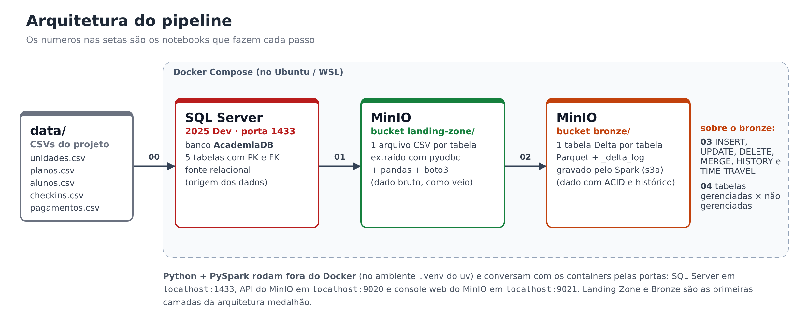

# Apache Spark com Delta Lake, MinIO e SQL Server


📘 **Documentação completa:** https://02kamk.github.io/spark-minio-delta-lake/

👥 **Integrantes:** Kamily Hilário das Luzes · Kauã Lucas Alves Barbosa

---

## Sumário

- [Descrição](#descrição)
- [Avisos](#avisos)
- [Pré-requisitos](#pré-requisitos)
- [Instalação](#instalação)
- [Howto — como executar](#howto--como-executar)
- [Testes](#testes)
- [Documentação](#documentação)
- [Referências](#referências)

---

## Descrição

Trabalho 2 da disciplina de **Engenharia de Dados (SATC)**, continuação do
[Trabalho 1](https://github.com/02kamk/apachespark). O projeto extrai as tabelas de um banco **SQL Server 2025**,
grava os dados em CSV no **MinIO** (bucket `landing-zone`), converte para **Delta Lake** (bucket `bronze`) com
**Apache Spark** e aplica comandos DML sobre as tabelas Delta.



O que cada etapa faz, o modelo de dados e a análise dos resultados estão na
[documentação](https://02kamk.github.io/spark-minio-delta-lake/). Este README cobre **como instalar,
executar e testar** o projeto.

---

## Avisos

> [!WARNING]
> **Use Linux.** O projeto foi feito e testado no **Ubuntu 24.04 dentro do WSL2** (Windows 11).
> Também funciona no Ubuntu instalado direto no computador. Windows "puro" não é suportado.

> [!IMPORTANT]
> **Memória:** o SQL Server precisa de pelo menos 2 GB de RAM só para ele, e o Spark de mais 2 GB.
> No WSL, garanta **pelo menos 6 GB** para o Ubuntu (veja a [Instalação, passo 1](#1-memória-do-wsl-só-para-quem-usa-wsl)).
> Rode **um notebook por vez**.

> [!IMPORTANT]
> **A primeira execução precisa de internet.** O Docker baixa as imagens do SQL Server e do MinIO (cerca de 1,5 GB) e o
> Spark baixa os pacotes do Delta Lake e do conector S3A (cerca de 300 MB, guardados em `~/.ivy2`).

> [!CAUTION]
> **Imagem do MinIO.** Em setembro de 2026 a MinIO removeu a imagem `minio/minio` do Docker Hub e tornou privada a do
> `quay.io` (erros `pull access denied` e `401 UNAUTHORIZED`). Por isso o projeto usa o **`pgsty/minio`**, fork mantido
> pela comunidade a partir do mesmo código-fonte, com o mesmo comando, variáveis, portas e console web.

> [!NOTE]
> - As senhas do `docker-compose.yml` e do `.env.example` são **de laboratório**. Não use em produção.
> - Os dados são **fictícios e criados pelo grupo** (`scripts/gerar_dados.py`).
> - As versões do PySpark, do Delta Lake e do `hadoop-aws` precisam combinar entre si. Não atualize uma sem conferir as outras.

---

## Pré-requisitos

### Ambiente

| Componente | Versão | Observação |
|---|---|---|
| Sistema operacional | Ubuntu 24.04 LTS (WSL2 ou nativo) | |
| Docker Engine + Docker Compose | 27+ / v2 | sobe o SQL Server e o MinIO |
| Java (OpenJDK) | 17 | o Spark roda na JVM |
| [uv](https://docs.astral.sh/uv/) | 0.8+ | gerencia o Python e as bibliotecas |
| Python | 3.11 | instalado automaticamente pelo uv |
| ODBC Driver 18 for SQL Server | 18 | usado pelo `pyodbc` para conectar ao SQL Server |
| VS Code + extensões Python, Jupyter e WSL | recente | opcional (também dá para usar o JupyterLab) |
| RAM disponível para o Ubuntu | 6 GB ou mais | SQL Server + Spark |

### Containers (`docker-compose.yml`)

| Container | Imagem | Portas | Usuário / senha |
|---|---|---|---|
| `sqlserver-2025` | `mcr.microsoft.com/mssql/server:2025-latest` | `1433` | `sa` / `SqlServer@2025!` |
| `minio` | `pgsty/minio:RELEASE.2026-06-18T00-00-00Z` | `9020` (API S3), `9021` (console web) | `minioadmin` / `minioadmin` |

### Bibliotecas Python (instaladas pelo `uv sync`, versões exatas no [`uv.lock`](uv.lock))

| Biblioteca | Versão | Para que serve |
|---|---|---|
| `pyspark` | 3.5.3 | Apache Spark para Python |
| `delta-spark` | 3.2.0 | API Python do Delta Lake (`DeltaTable`) |
| `pyodbc` | 5.x | conexão com o SQL Server |
| `pandas` | 2.x | leitura e escrita dos CSVs |
| `boto3` | 1.x | cliente S3 para o MinIO (buckets e arquivos) |
| `python-dotenv` | 1.x | lê as configurações do arquivo `.env` |
| `jupyterlab` / `ipykernel` | 4.x / 7.x | execução dos notebooks |
| `mkdocs` / `mkdocs-material` *(dev)* | 1.6 / 9.x | site de documentação |

### Pacotes do Spark (`.jar`, baixados automaticamente na primeira SparkSession)

| Pacote | Versão |
|---|---|
| `io.delta:delta-spark_2.12` | 3.2.0 |
| `org.apache.hadoop:hadoop-aws` | 3.3.4 (mesma versão do Hadoop que vem no PySpark 3.5.3) |

---

## Instalação

Todos os comandos são no **terminal do Ubuntu**.

### 1. Memória do WSL (só para quem usa WSL)

Confira quanta memória o Ubuntu enxerga:

```bash
free -h
```

Se o total da linha `Mem:` for **menor que 6 GB**, crie no **Windows** o arquivo `C:\Users\<seu-usuario>\.wslconfig` com:

```ini
[wsl2]
memory=6GB
```

Depois, no **PowerShell do Windows**, rode `wsl --shutdown` e abra o Ubuntu de novo.

### 2. Pacotes do sistema (Git, Java 17 e utilitários)

```bash
sudo apt update
sudo apt install -y git curl unzip ca-certificates openjdk-17-jdk
java -version
```

### 3. Docker Engine

> Já usa o **Docker Desktop** com integração WSL ativada? Pule para o passo 4.

```bash
curl -fsSL https://get.docker.com -o get-docker.sh
sudo sh get-docker.sh
sudo usermod -aG docker $USER
```

Feche e abra o terminal (no WSL: `wsl --shutdown` no PowerShell e abra o Ubuntu de novo) e teste:

```bash
docker run --rm hello-world
docker compose version
```

<details>
<summary>Erro "Cannot connect to the Docker daemon"?</summary>

O serviço do Docker não está rodando. Inicie com:

```bash
sudo systemctl start docker     # se o WSL estiver com systemd
sudo service docker start       # alternativa
```

</details>

### 4. ODBC Driver 18 for SQL Server

```bash
sudo apt install -y unixodbc unixodbc-dev
curl -sSL -O https://packages.microsoft.com/config/ubuntu/24.04/packages-microsoft-prod.deb
sudo dpkg -i packages-microsoft-prod.deb
rm packages-microsoft-prod.deb
sudo apt update
sudo ACCEPT_EULA=Y apt install -y msodbcsql18
odbcinst -q -d
```

O pacote `packages-microsoft-prod.deb` instala o repositório da Microsoft **junto com a chave de assinatura**
(é o método recomendado pela Microsoft para o Ubuntu 24.04).

O último comando deve mostrar `[ODBC Driver 18 for SQL Server]`.

### 5. uv

```bash
curl -LsSf https://astral.sh/uv/install.sh | sh
source ~/.bashrc
uv --version
```

### 6. Clonar o repositório e configurar

```bash
mkdir -p ~/projetos && cd ~/projetos
git clone https://github.com/02kamk/spark-minio-delta-lake.git
cd spark-minio-delta-lake
cp .env.example .env
uv sync
```

O `uv sync` baixa o Python 3.11 (se necessário), cria a pasta `.venv` e instala as versões exatas do `uv.lock`.

### 7. Subir os containers

```bash
docker compose up -d
docker compose ps
```

Os dois containers (`sqlserver-2025` e `minio`) devem aparecer com status `Up`. O SQL Server leva cerca de
30 segundos para aceitar conexões depois de subir.

### 8. Conferir a instalação

```bash
uv run python -c "import pyspark, delta, pyodbc, boto3; print('PySpark', pyspark.__version__)"
```

Saída esperada: `PySpark 3.5.3`. Console do MinIO: http://localhost:9021 (`minioadmin` / `minioadmin`).

<details>
<summary>Como este ambiente foi criado do zero (apenas para registro)</summary>

```bash
uv init --name spark-minio-delta-lake --python 3.11
uv add pyspark==3.5.3 delta-spark==3.2.0 jupyterlab ipykernel pandas pyodbc boto3 python-dotenv
uv add --dev "mkdocs>=1.6.1,<2" "mkdocs-material>=9.7.7,<10"
```

</details>

---

## Howto — como executar

### Ordem dos notebooks

Execute os notebooks da pasta `notebooks/` **em ordem**, um de cada vez:

1. `00_setup_sqlserver.ipynb`
2. `01_sqlserver_to_minio_csv.ipynb`
3. `02_csv_to_delta.ipynb`
4. `03_dml_delta.ipynb`
5. `04_gerenciadas_vs_nao_gerenciadas.ipynb`

O que cada um faz está explicado na [documentação](https://02kamk.github.io/spark-minio-delta-lake/).

> [!TIP]
> Para rodar o `03` de novo, rode antes o `02`: ele recarrega o bucket `bronze` a partir da `landing-zone`.

### Pelo VS Code

1. Na pasta do projeto, rode `code .` e confira **WSL: Ubuntu** no canto inferior esquerdo.
2. Abra o notebook, clique em **Select Kernel** → **Python Environments** → **.venv (Python 3.11)**.
3. Clique em **Run All**. Espere o último resultado antes de abrir o próximo notebook.

### Pelo JupyterLab

```bash
uv run jupyter lab
```

Abra o link `http://localhost:8888/lab?token=...` exibido no terminal e use **Run → Run All Cells**.

### Acompanhar os dados

| O quê | Onde |
|---|---|
| Buckets e arquivos do MinIO | http://localhost:9021 (`minioadmin` / `minioadmin`) |
| Jobs do Spark (enquanto um notebook roda) | http://localhost:4040 |

### Parar, liberar memória e recomeçar

```bash
docker stop sqlserver-2025   # depois do notebook 01, o SQL Server não é mais usado
docker compose stop          # para os containers (os dados ficam guardados)
docker compose start         # sobe de novo
docker compose down -v       # APAGA tudo (banco e buckets) para recomeçar do zero
```

### Estrutura do repositório

```text
spark-minio-delta-lake/
├── data/                 # CSVs de origem (5 tabelas)
├── docs/                 # páginas do MkDocs (+ assets/ com as imagens)
├── notebooks/            # notebooks 00 a 04
├── scripts/
│   └── gerar_dados.py    # gera os CSVs de data/ (determinístico)
├── docker-compose.yml    # SQL Server 2025 + MinIO
├── .env.example          # modelo das configurações (copiar para .env)
├── mkdocs.yml
├── pyproject.toml / uv.lock / .python-version
└── README.md
```

---

## Testes

Os notebooks terminam com células de **verificação automática** (`assert`): o `00` compara o SQL Server com os CSVs,
o `01` confere os arquivos no MinIO, o `02` compara as tabelas Delta com os CSVs, o `03` confere os resultados dos DML
(por exemplo, plano Mensal = 109,89 e 301 alunos) e o `04` confere o comportamento do `DROP TABLE`.
Se algo estiver errado, a célula falha com `AssertionError` e mostra qual verificação quebrou.

Para rodar tudo pelo terminal, sem abrir o VS Code (com os containers no ar):

```bash
for nb in 00_setup_sqlserver 01_sqlserver_to_minio_csv 02_csv_to_delta 03_dml_delta 04_gerenciadas_vs_nao_gerenciadas; do
  uv run jupyter nbconvert --to notebook --execute --inplace "notebooks/$nb.ipynb" || { echo "FALHOU: $nb"; break; }
done && echo "TODOS OS NOTEBOOKS PASSARAM"
```

Para validar a documentação (falha se houver link ou imagem quebrada):

```bash
uv run mkdocs build --strict
```

### Problemas comuns

| Erro | Causa | Solução |
|---|---|---|
| `Can't open lib 'ODBC Driver 18 for SQL Server'` | driver ODBC não instalado | refaça o passo 4 da Instalação |
| `ImportError: libodbc.so.2` | falta o unixODBC | `sudo apt install -y unixodbc-dev` |
| `Login timeout expired` no notebook 00 | SQL Server ainda iniciando ou parado | espere 30 s; confira `docker compose ps` |
| `Could not connect to the endpoint URL` | MinIO parado | `docker compose up -d` |
| `FileNotFoundError: Arquivo .env não encontrado` | `.env` não foi criado | `cp .env.example .env` |
| Kernel morre / VS Code mostra "disconnected" | falta de memória | aumente a memória do WSL (passo 1) e rode um notebook por vez |
| `RuntimeError: Os DML deste notebook já foram aplicados` | `03` rodado duas vezes | rode o `02` e depois o `03` |

---

## Documentação

📘 **https://02kamk.github.io/spark-minio-delta-lake/**

Para ver localmente: `uv run mkdocs serve` e abrir http://127.0.0.1:8000.
Para publicar uma nova versão no GitHub Pages: `uv run mkdocs gh-deploy`.

---

## Referências

- [Repositório de exemplo do professor: jlsilva01/spark-delta-minio-sqlserver](https://github.com/jlsilva01/spark-delta-minio-sqlserver)
- [Delta Lake — Releases e compatibilidade](https://docs.delta.io/latest/releases.html)
- [Delta Lake — Table deletes, updates, and merges](https://docs.delta.io/latest/delta-update.html)
- [Hadoop AWS (S3A)](https://hadoop.apache.org/docs/r3.3.4/hadoop-aws/tools/hadoop-aws/index.html)
- [MinIO — Documentação](https://min.io/docs/minio/linux/index.html)
- [SQL Server em containers Docker](https://learn.microsoft.com/sql/linux/quickstart-install-connect-docker)
- [ODBC Driver for SQL Server no Linux](https://learn.microsoft.com/sql/connect/odbc/linux-mac/installing-the-microsoft-odbc-driver-for-sql-server)
- [Docker Engine no Ubuntu](https://docs.docker.com/engine/install/ubuntu/)
- [uv — Documentação](https://docs.astral.sh/uv/)
