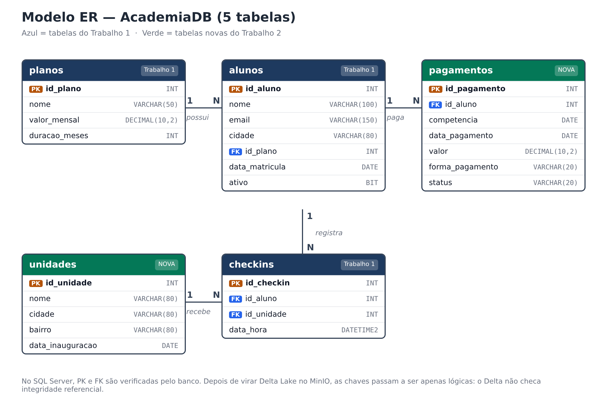

# Cenário e modelo de dados

O cenário é o mesmo do Trabalho 1, uma **academia**, agora com mais detalhes. Além dos planos, alunos e
check-ins, a academia passou a ter **várias unidades** (filiais) e a registrar os **pagamentos** das mensalidades.
São 5 tabelas, 2 delas novas.



## As 5 tabelas

| Tabela | O que guarda | Registros | Novidade |
|---|---|---|---|
| `unidades` | as filiais da academia (Centro, Próspera, Pinheirinho, Içara) | 4 | **nova** |
| `planos` | planos vendidos e seu valor | 4 | ganhou o plano Semestral |
| `alunos` | cadastro dos alunos e o plano de cada um | 300 | 5 do Trabalho 1 + 295 gerados |
| `checkins` | cada entrada de um aluno numa unidade | 7.684 | `unidade` (texto) virou `id_unidade` (FK) |
| `pagamentos` | uma mensalidade por aluno e por mês, com status | 2.156 | **nova** |

Os relacionamentos:

- um **plano** tem vários **alunos**;
- um **aluno** registra vários **check-ins** e faz vários **pagamentos**;
- uma **unidade** recebe vários **check-ins**.

!!! note "Por que `id_unidade` em vez do nome da unidade?"
    No Trabalho 1, `checkins` guardava o nome da unidade como texto (`'Centro'`). Com a tabela `unidades`, o check-in
    passa a guardar só o código, e o nome fica num lugar só. Se uma unidade mudar de nome, muda uma linha, e não milhares.
    Isso é **normalização**, típica de bancos relacionais como o SQL Server.

## DDL no SQL Server

No SQL Server as chaves são **reais**: o banco recusa um check-in de um aluno que não existe.
O notebook `00` cria as tabelas na ordem das dependências.

```sql
CREATE TABLE dbo.unidades (
    id_unidade        INT          NOT NULL PRIMARY KEY,
    nome              VARCHAR(80)  NOT NULL,
    cidade            VARCHAR(80)  NOT NULL,
    bairro            VARCHAR(80)  NULL,
    data_inauguracao  DATE         NULL
);

CREATE TABLE dbo.planos (
    id_plano       INT            NOT NULL PRIMARY KEY,
    nome           VARCHAR(50)    NOT NULL,
    valor_mensal   DECIMAL(10,2)  NOT NULL,
    duracao_meses  INT            NOT NULL
);

CREATE TABLE dbo.alunos (
    id_aluno        INT           NOT NULL PRIMARY KEY,
    nome            VARCHAR(100)  NOT NULL,
    email           VARCHAR(150)  NULL,
    cidade          VARCHAR(80)   NULL,
    id_plano        INT           NOT NULL,
    data_matricula  DATE          NULL,
    ativo           BIT           NOT NULL,
    CONSTRAINT fk_alunos_planos FOREIGN KEY (id_plano) REFERENCES dbo.planos (id_plano)
);

CREATE TABLE dbo.checkins (
    id_checkin  INT           NOT NULL PRIMARY KEY,
    id_aluno    INT           NOT NULL,
    id_unidade  INT           NOT NULL,
    data_hora   DATETIME2(0)  NOT NULL,
    CONSTRAINT fk_checkins_alunos   FOREIGN KEY (id_aluno)   REFERENCES dbo.alunos (id_aluno),
    CONSTRAINT fk_checkins_unidades FOREIGN KEY (id_unidade) REFERENCES dbo.unidades (id_unidade)
);

CREATE TABLE dbo.pagamentos (
    id_pagamento     INT            NOT NULL PRIMARY KEY,
    id_aluno         INT            NOT NULL,
    competencia      DATE           NOT NULL,   -- mês de referência da mensalidade
    data_pagamento   DATE           NULL,       -- vazio enquanto não foi pago
    valor            DECIMAL(10,2)  NOT NULL,
    forma_pagamento  VARCHAR(20)    NULL,       -- PIX, CARTAO, BOLETO
    status           VARCHAR(20)    NOT NULL,   -- PAGO, PENDENTE, ATRASADO
    CONSTRAINT fk_pagamentos_alunos FOREIGN KEY (id_aluno) REFERENCES dbo.alunos (id_aluno)
);
```

## Conjunto de dados

Os dados são **fictícios e criados pelo grupo** com o script `scripts/gerar_dados.py`, que usa uma semente fixa:
rodar de novo gera exatamente os mesmos arquivos. Os CSVs ficam na pasta `data/` do repositório.

Para que os DML do Trabalho 1 possam ser **reproduzidos** no bronze, o conjunto começa com os mesmos registros do Trabalho 1:

| O que foi mantido do Trabalho 1 | Por quê |
|---|---|
| planos 1 a 3 (Mensal 99,90 · Trimestral 269,70 · Anual 899,00) | o UPDATE de reajuste de 10% no plano Mensal |
| alunos 1 a 5 (Ana, Bruno, Carla, Diego, Elisa) | o UPDATE da Ana, o DELETE do Diego e o MERGE da Carla |
| check-ins 1 a 8 | o Diego tem os mesmos 2 check-ins (ids 5 e 7) |

O restante foi gerado com regras simples, para ter volume e variedade:

| Tabela | Regras de geração |
|---|---|
| `alunos` | 295 alunos com nomes combinados, matrícula entre jan/2023 e jun/2024, cerca de 85% ativos |
| `checkins` | junho a agosto de 2024; alunos ativos vão de 1 a 3,5 vezes por semana, quase sempre na unidade mais próxima |
| `pagamentos` | uma mensalidade por mês de jan a ago/2024 (a partir da matrícula); inativos ficam `ATRASADO`; parte de agosto fica `PENDENTE` |

Distribuição dos pagamentos por status: **1.852 PAGO**, **241 ATRASADO** e **63 PENDENTE**.

=== "unidades"

    | id_unidade | nome | cidade | bairro | data_inauguracao |
    |---|---|---|---|---|
    | 1 | Centro | Criciúma | Centro | 2015-03-02 |
    | 2 | Próspera | Criciúma | Próspera | 2018-08-13 |
    | 3 | Pinheirinho | Criciúma | Pinheirinho | 2021-02-01 |
    | 4 | Içara | Içara | Centro | 2023-05-15 |

=== "planos"

    | id_plano | nome | valor_mensal | duracao_meses |
    |---|---|---|---|
    | 1 | Mensal | 99.90 | 1 |
    | 2 | Trimestral | 269.70 | 3 |
    | 3 | Anual | 899.00 | 12 |
    | 4 | Semestral | 509.40 | 6 |

=== "alunos (primeiros 5)"

    | id_aluno | nome | cidade | id_plano | data_matricula | ativo |
    |---|---|---|---|---|---|
    | 1 | Ana Souza | Criciúma | 1 | 2024-01-10 | True |
    | 2 | Bruno Lima | Içara | 3 | 2024-02-05 | True |
    | 3 | Carla Mendes | Criciúma | 2 | 2024-03-12 | True |
    | 4 | Diego Rocha | Forquilhinha | 1 | 2024-04-20 | False |
    | 5 | Elisa Martins | Criciúma | 3 | 2024-05-02 | True |

=== "pagamentos do Diego"

    | id_pagamento | id_aluno | competencia | data_pagamento | valor | forma | status |
    |---|---|---|---|---|---|---|
    | 22 | 4 | 2024-04-01 | 2024-04-13 | 99.90 | PIX | PAGO |
    | 23 | 4 | 2024-05-01 | 2024-05-04 | 99.90 | BOLETO | PAGO |
    | 24 | 4 | 2024-06-01 | | 99.90 | BOLETO | ATRASADO |
    | 25 | 4 | 2024-07-01 | | 99.90 | PIX | ATRASADO |
    | 26 | 4 | 2024-08-01 | | 99.90 | CARTAO | ATRASADO |
