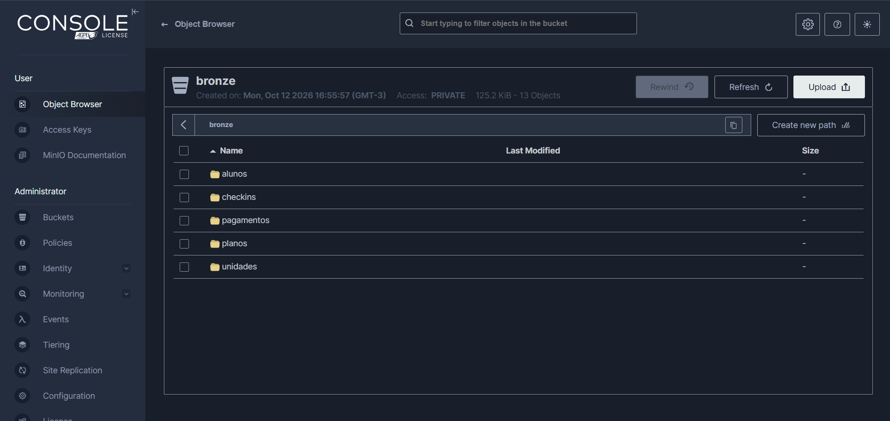
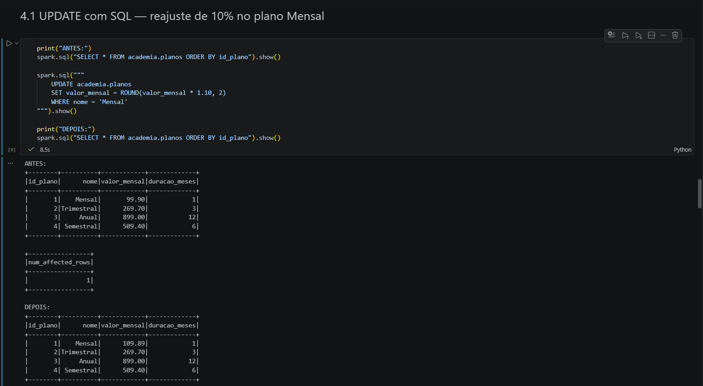
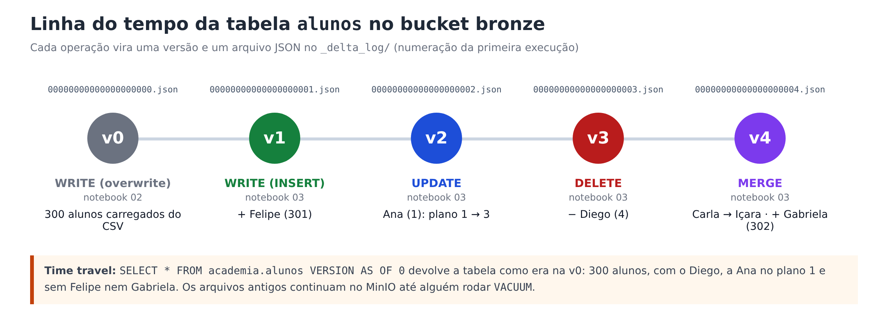
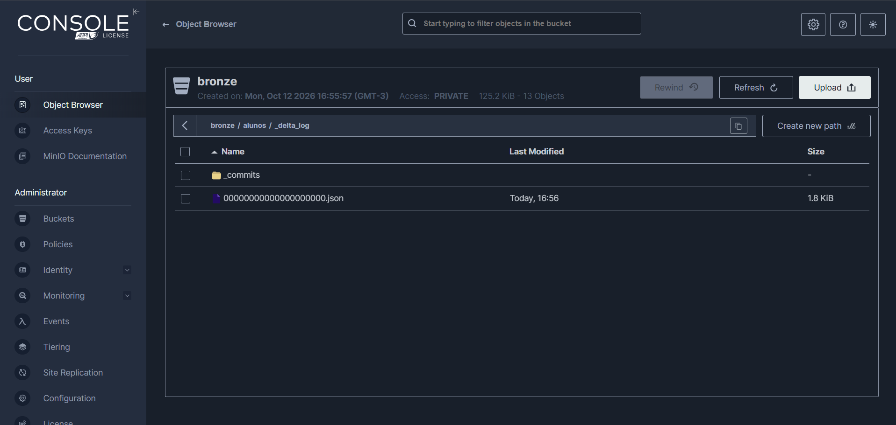
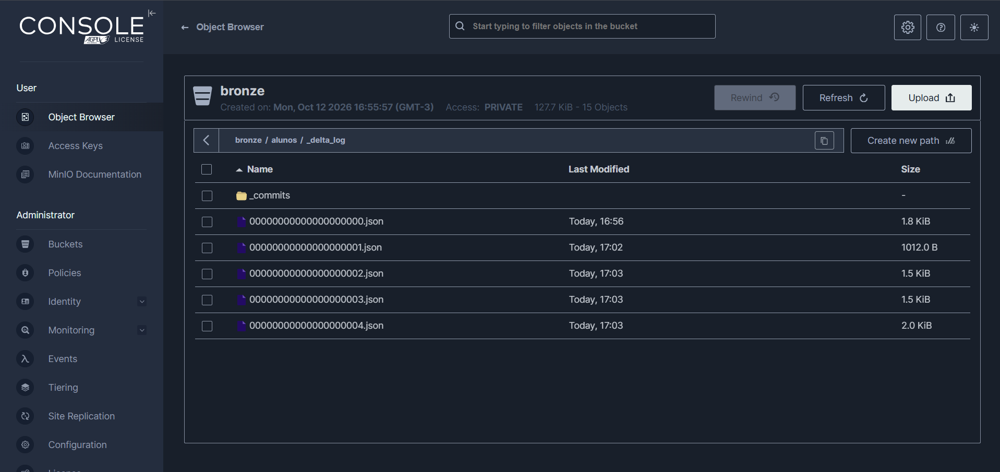

# Bronze: Delta Lake e DML

Esta etapa cobre os itens 2 e 3 do enunciado: transformar os CSVs da `landing-zone` em tabelas **Delta Lake** no
bucket `bronze` (notebook `02`) e reproduzir sobre elas os **INSERT, UPDATE e DELETE** do Trabalho 1 (notebook `03`).

## O Spark conversando com o MinIO

O Spark não sabe falar com o MinIO sozinho. Ele usa o conector **S3A** (pacote `hadoop-aws`), o mesmo usado para
o Amazon S3. Como o MinIO imita a API do S3, basta apontar o endereço para `localhost:9020`. A partir daí, os
caminhos das tabelas passam a começar com `s3a://`.

```python
spark = (
    SparkSession.builder
    .config("spark.jars.packages", "io.delta:delta-spark_2.12:3.2.0,org.apache.hadoop:hadoop-aws:3.3.4")
    .config("spark.sql.extensions", "io.delta.sql.DeltaSparkSessionExtension")
    .config("spark.sql.catalog.spark_catalog", "org.apache.spark.sql.delta.catalog.DeltaCatalog")
    .config("spark.hadoop.fs.s3a.endpoint", MINIO_ENDPOINT)          # http://localhost:9020
    .config("spark.hadoop.fs.s3a.access.key", MINIO_ACCESS_KEY)
    .config("spark.hadoop.fs.s3a.secret.key", MINIO_SECRET_KEY)
    .config("spark.hadoop.fs.s3a.path.style.access", "true")        # MinIO usa caminho, não subdomínio
    .config("spark.hadoop.fs.s3a.connection.ssl.enabled", "false")  # laboratório local, sem HTTPS
    .getOrCreate()
)
```

!!! info "Por que `hadoop-aws` 3.3.4?"
    O PySpark 3.5.3 vem com as bibliotecas do Hadoop 3.3.4. O `hadoop-aws` precisa ser **exatamente** da mesma versão;
    outra versão causa erros como `NoSuchMethodError` ou `ClassNotFoundException`.

## Notebook 02 — CSV → Delta Lake

Para cada tabela, o Spark lê o CSV com um **esquema declarado** e grava em Delta no bucket `bronze`:

```python
SCHEMAS = {
    "unidades":   "id_unidade INT, nome STRING, cidade STRING, bairro STRING, data_inauguracao DATE",
    "planos":     "id_plano INT, nome STRING, valor_mensal DECIMAL(10,2), duracao_meses INT",
    "alunos":     "id_aluno INT, nome STRING, email STRING, cidade STRING, id_plano INT, data_matricula DATE, ativo BOOLEAN",
    "checkins":   "id_checkin INT, id_aluno INT, id_unidade INT, data_hora TIMESTAMP",
    "pagamentos": "id_pagamento INT, id_aluno INT, competencia DATE, data_pagamento DATE, valor DECIMAL(10,2), "
                  "forma_pagamento STRING, status STRING",
}

df = (spark.read.option("header", "true").option("mode", "FAILFAST")
      .schema(SCHEMAS[tabela]).csv(f"s3a://landing-zone/{tabela}.csv"))

df.write.format("delta").mode("overwrite").save(f"s3a://bronze/{tabela}")
```

Duas escolhas importantes:

- **Esquema declarado em vez de `inferSchema`.** Se o Spark adivinhasse os tipos, `valor_mensal` viraria `double`
  (com problemas de arredondamento em dinheiro) e as datas poderiam virar texto. Declarando, os tipos voltam a ser os do SQL Server.
- **`mode = FAILFAST`.** Se alguma linha vier fora do formato, a leitura falha na hora, em vez de transformar o valor em nulo
  silenciosamente. É melhor descobrir o problema no bronze do que num relatório.

| Tipo no SQL Server | No CSV | No Delta (Spark) |
|---|---|---|
| `INT` | `301` | `INT` |
| `DECIMAL(10,2)` | `99.90` | `DECIMAL(10,2)` |
| `DATE` | `2024-06-10` | `DATE` |
| `DATETIME2(0)` | `2024-06-03 07:15:00` | `TIMESTAMP` |
| `BIT` | `True` | `BOOLEAN` |
| `NULL` | *(campo vazio)* | `NULL` |

Resultado real no console do MinIO depois do notebook `02`: uma pasta por tabela no bucket `bronze`.



Cada tabela vira uma **pasta** no bucket, com os dados em Parquet e o log de transações em `_delta_log/`
(veja a imagem em [SQL Server → Landing Zone](extracao.md#o-que-fica-no-minio)).

## Notebook 03 — DML no bronze

Primeiro, as pastas do bucket são **registradas** como tabelas no Spark SQL, para podermos usar SQL comum:

```python
spark.sql("CREATE DATABASE IF NOT EXISTS academia")
for t in ["unidades", "planos", "alunos", "checkins", "pagamentos"]:
    spark.sql(f"CREATE TABLE IF NOT EXISTS academia.{t} USING delta LOCATION 's3a://bronze/{t}'")
```

O `LOCATION` faz delas tabelas **não gerenciadas** (externas). O porquê disso está em
[Gerenciadas × não gerenciadas](gerenciadas.md).

Em seguida, os mesmos DML do Trabalho 1, agora sobre dados que estão no MinIO:

### INSERT

=== "SQL"

    ```sql
    INSERT INTO academia.alunos VALUES
      (301, 'Felipe Costa', 'felipe@email.com', 'Criciúma', 2, DATE '2024-06-10', true)
    ```

=== "DataFrame (check-in do Felipe)"

    ```python
    novo_checkin = spark.createDataFrame(
        [(proximo_id, 301, 3, datetime(2024, 6, 11, 7, 30))],
        schema="id_checkin INT, id_aluno INT, id_unidade INT, data_hora TIMESTAMP",
    )
    novo_checkin.write.format("delta").mode("append").save("s3a://bronze/checkins")
    ```

=== "INSERT ... SELECT (pagamento)"

    ```sql
    INSERT INTO academia.pagamentos
    SELECT MAX(id_pagamento) + 1, 301, DATE '2024-06-01', DATE '2024-06-10', 89.90, 'PIX', 'PAGO'
    FROM academia.pagamentos
    ```

### UPDATE

=== "SQL — reajuste do plano Mensal"

    ```sql
    UPDATE academia.planos
    SET valor_mensal = ROUND(valor_mensal * 1.10, 2)
    WHERE nome = 'Mensal'
    ```

=== "API DeltaTable — Ana troca de plano"

    ```python
    DeltaTable.forPath(spark, "s3a://bronze/alunos").update(
        condition="id_aluno = 1",
        set={"id_plano": lit(3)},
    )
    ```

| id_plano | nome | valor_mensal antes | valor_mensal depois |
|---|---|---|---|
| 1 | Mensal | 99.90 | **109.89** |
| 2 | Trimestral | 269.70 | 269.70 |
| 3 | Anual | 899.00 | 899.00 |
| 4 | Semestral | 509.40 | 509.40 |

??? example "Ver a execução real no notebook 03"
    

### DELETE

O aluno Diego (id 4) cancelou. Agora que existem pagamentos, o DELETE envolve três tabelas:

```python
for tabela in ["checkins", "pagamentos", "alunos"]:
    spark.sql(f"DELETE FROM academia.{tabela} WHERE id_aluno = 4")
```

| Tabela | Linhas do Diego antes | Depois |
|---|---|---|
| `checkins` | 2 | 0 |
| `pagamentos` | 5 | 0 |
| `alunos` | 1 | 0 |

!!! warning "O Delta não protege as chaves estrangeiras"
    No SQL Server, apagar o Diego antes dos pagamentos dele daria erro de FK. No Delta Lake, daria certo e deixaria
    5 pagamentos "órfãos". Por isso, no bronze, **a ordem certa é responsabilidade de quem escreve o pipeline**.

### MERGE (bônus)

```sql
MERGE INTO academia.alunos AS destino
USING lote_alunos AS origem
ON destino.id_aluno = origem.id_aluno
WHEN MATCHED THEN UPDATE SET *        -- Carla (3) muda para Içara
WHEN NOT MATCHED THEN INSERT *        -- Gabriela (302) é inserida
```

## HISTORY e TIME TRAVEL



No MinIO dá para ver esse "diário" de verdade, na pasta `bronze/alunos/_delta_log/`:

=== "Antes do notebook 03"

    Só a versão 0, criada pelo notebook `02` ao gravar os 300 alunos.

    

=== "Depois do notebook 03"

    Uma versão nova (um arquivo `.json`) para cada operação: INSERT, UPDATE, DELETE e MERGE.

    

!!! note "E a pasta `_commits`?"
    É uma pasta de trabalho interna do Delta Lake 3.x, usada durante a gravação dos commits. O histórico da tabela
    está nos arquivos `.json` numerados.

```python
spark.sql("DESCRIBE HISTORY academia.alunos").show()

# a versão de antes dos DML é guardada no começo do notebook
spark.sql(f"SELECT * FROM academia.alunos VERSION AS OF {versao_inicial['alunos']}").show()
```

O notebook guarda a versão de cada tabela **antes** dos DML, em vez de escrever um número fixo. Assim o time travel
continua certo mesmo se o notebook `02` for rodado mais de uma vez (cada `overwrite` cria uma versão nova).

## Verificações automáticas

O notebook `03` termina conferindo os resultados com `assert`. Se algum falhar, a execução para e mostra qual:

| Verificação | Esperado |
|---|---|
| valor do plano Mensal | 109.89 |
| plano da Ana (1) | 3 (Anual) |
| cidade da Carla (3) | Içara |
| Felipe (301) e Gabriela (302) | existem |
| linhas do Diego (4) em `alunos`, `checkins` e `pagamentos` | 0 |
| total de alunos | 301 (300 + 2 inseridos − 1 removido) |
| time travel para a versão inicial | 300 alunos, com o Diego |
