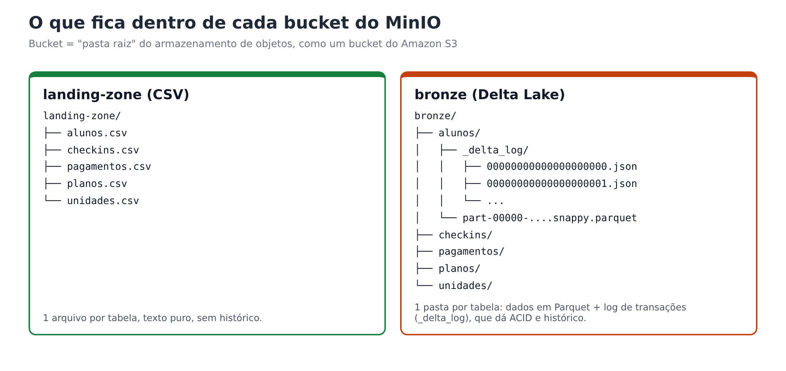
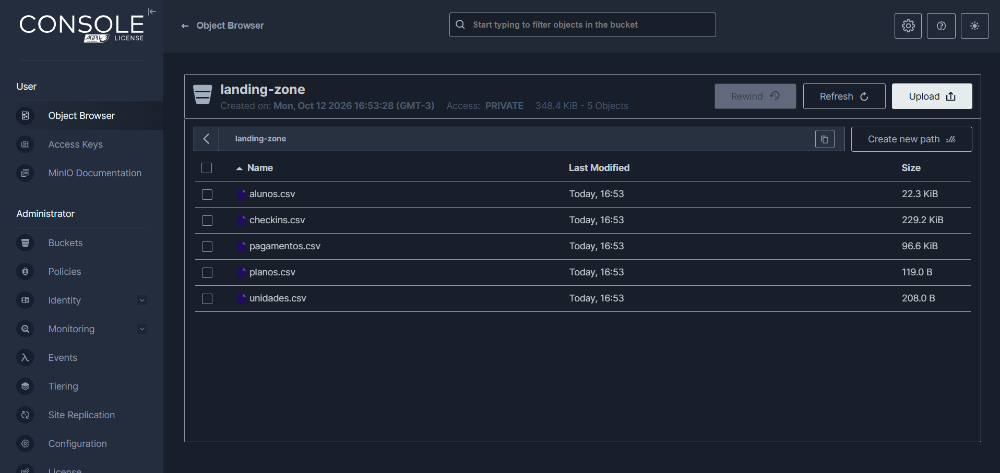

# SQL Server → Landing Zone

Esta etapa cobre o item 1 do enunciado: tirar os dados do banco relacional e deixá-los no Data Lake,
**do jeito que vieram**, em CSV. São os notebooks `00` (prepara a fonte) e `01` (faz a extração).


## Por que dois sistemas diferentes?

O SQL Server e o MinIO resolvem problemas diferentes. O **SQL Server** é um banco **transacional**: é ótimo para
gravar e consultar registros um a um, com regras (PK, FK, tipos) garantidas pelo próprio banco. É onde um sistema
de academia guardaria os dados no dia a dia. O **MinIO** é um **armazenamento de objetos**: guarda arquivos de qualquer
tamanho, de forma barata e escalável, e fala a mesma "língua" (API) do Amazon S3. É onde se monta um Data Lake.

Copiar do primeiro para o segundo permite analisar grandes volumes **sem pesar no banco do sistema**.

## Notebook 00 — preparar a fonte

O notebook `00` faz o papel do "sistema da academia": cria o banco `AcademiaDB`, as 5 tabelas com PK e FK
(o DDL está em [Cenário e modelo de dados](dados.md#ddl-no-sql-server)) e carrega os CSVs da pasta `data/`.

Três detalhes de implementação:

- **Espera o SQL Server ficar pronto.** O container leva uns 30 segundos para aceitar conexões; a função `conectar()`
  tenta de novo a cada 5 segundos em vez de falhar na primeira.
- **Respeita as FKs.** As tabelas são criadas e carregadas na ordem `unidades → planos → alunos → checkins → pagamentos`.
  Carregar `checkins` antes de `alunos` seria recusado pelo banco.
- **Pode ser rodado de novo.** Tabela que já tem dados é pulada, então nada é duplicado.

No final, o notebook comprova que as FKs estão valendo: tenta inserir um check-in de um aluno inexistente e o
SQL Server recusa. Essa garantia **não existe** no Delta Lake, como veremos na camada bronze.

```python
# conexão via ODBC Driver 18 (pyodbc)
conn_str = (
    "DRIVER={ODBC Driver 18 for SQL Server};"
    f"SERVER={DB_SERVER},{DB_PORT};DATABASE={database};"
    f"UID={DB_USER};PWD={DB_PASSWORD};TrustServerCertificate=yes;"
)
```

## Notebook 01 — extrair para a `landing-zone`

O notebook `01` faz a extração de verdade, em quatro passos:

1. **Descobre as tabelas** consultando o próprio banco (`INFORMATION_SCHEMA.TABLES`), em vez de usar uma lista fixa.
   Se amanhã surgir uma sexta tabela, ela também é extraída.
2. **Cria o bucket** `landing-zone` no MinIO, se ainda não existir (via `boto3`).
3. **Para cada tabela:** `SELECT *` → DataFrame do pandas → texto CSV na memória → `put_object` no MinIO.
   O arquivo nunca passa pelo disco do computador.
4. **Valida** que existe um `.csv` para cada tabela no bucket.

```python
for tabela in tabelas:
    cursor.execute(f"SELECT * FROM dbo.[{tabela}]")
    colunas = [d[0] for d in cursor.description]
    df = pd.DataFrame.from_records([tuple(l) for l in cursor.fetchall()], columns=colunas)

    buffer = io.StringIO()
    df.to_csv(buffer, index=False)
    s3.put_object(Bucket=LANDING_BUCKET, Key=f"{tabela}.csv",
                  Body=buffer.getvalue().encode("utf-8"), ContentType="text/csv")
```

## O que fica no MinIO



| Arquivo na `landing-zone` | Registros | Tamanho aproximado |
|---|---|---|
| `unidades.csv` | 4 | 0,2 KB |
| `planos.csv` | 4 | 0,1 KB |
| `alunos.csv` | 300 | 23 KB |
| `checkins.csv` | 7.684 | 237 KB |
| `pagamentos.csv` | 2.156 | 99 KB |

!!! question "Por que CSV na landing zone?"
    O enunciado pede CSV para fontes relacionais (e JSON para não relacionais). O CSV é simples, legível por qualquer
    ferramenta e representa bem uma tabela. A desvantagem é que ele **não guarda tipos**: `99.90`, `2024-06-03` e `True`
    viram só texto. Por isso, na próxima etapa, o Spark lê os CSVs com um **esquema declarado**, devolvendo a cada coluna
    o tipo que ela tinha no SQL Server.

Resultado real no console do MinIO depois do notebook `01`: o bucket `landing-zone` com os 5 arquivos.



!!! tip "Veja com os próprios olhos"
    Com os containers no ar, abra o console do MinIO em `http://localhost:9021` (usuário e senha `minioadmin`),
    clique em **Object Browser** e entre no bucket `landing-zone`: os 5 arquivos estarão lá, e dá para baixar e abrir qualquer um.

!!! warning "Um problema real no meio do caminho"
    Durante o trabalho, a imagem oficial `minio/minio` deixou de existir no Docker Hub (a MinIO removeu as imagens
    da comunidade em setembro de 2026) e a do `quay.io` passou a exigir login. O pipeline foi mantido trocando a imagem
    pelo **`pgsty/minio`**, um *fork* da comunidade compilado do mesmo código-fonte. Como o MinIO fala a API do S3,
    nada mais precisou mudar: nem o boto3, nem o conector S3A do Spark. É um bom exemplo de por que fixar versões e
    ter alternativas para cada dependência de infraestrutura.

