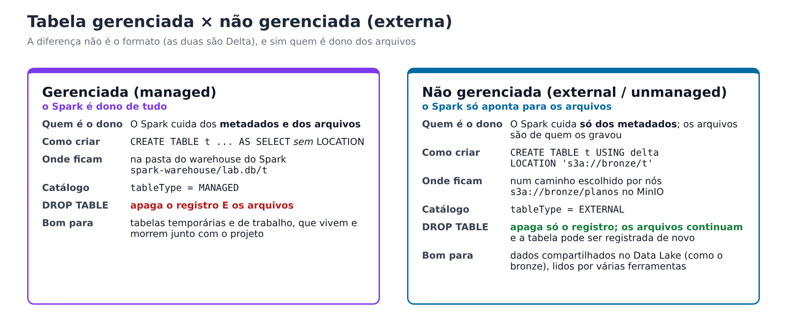
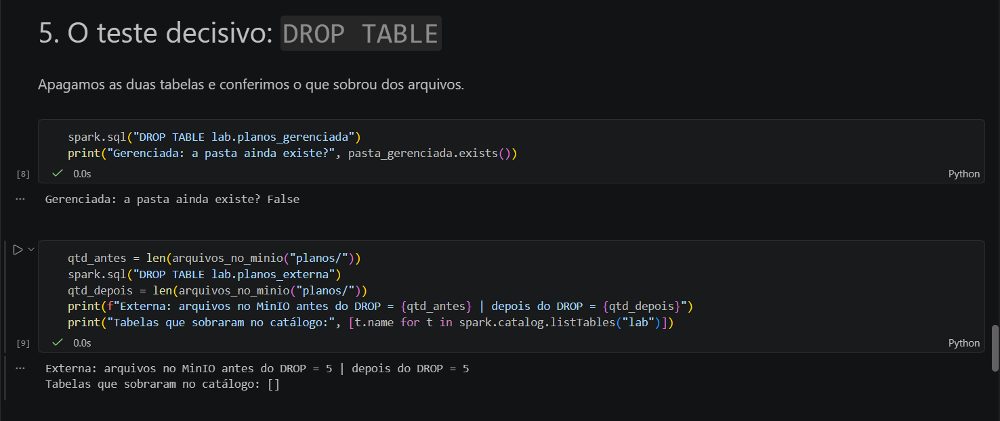

# Gerenciadas × não gerenciadas

Item 4 do enunciado: analisar a diferença entre tabelas **gerenciadas** (*managed*) e **não gerenciadas**
(*unmanaged*, também chamadas de **externas**). O notebook `04` faz essa comparação na prática.



## A ideia em palavras simples

Toda tabela no Spark tem duas partes: o **registro no catálogo** (nome, colunas, onde estão os dados) e os
**arquivos** com os dados. A pergunta é: quem é dono dos arquivos?

Pense em duas formas de guardar uma bicicleta. Num **estacionamento com manobrista**, você entrega a bicicleta,
ele escolhe a vaga e, quando você cancela o serviço, ele devolve tudo e a vaga fica vazia. Na **sua própria garagem**,
o condomínio só anota "a bicicleta do apartamento 12 fica na garagem 3"; se você sair da lista do condomínio, a bicicleta
continua lá.

- **Gerenciada** é o manobrista: o Spark escolhe onde gravar e, no `DROP TABLE`, apaga o registro **e os arquivos**.
- **Não gerenciada (externa)** é a garagem própria: o Spark só anota onde os arquivos estão; no `DROP TABLE`,
  apaga **só o registro**, e os arquivos continuam onde estavam.

## O experimento do notebook 04

Usamos a tabela `planos` do bucket `bronze` e criamos uma tabela de cada tipo:

```sql
-- não gerenciada (externa): aponta para os arquivos que já estão no MinIO
CREATE TABLE lab.planos_externa
USING delta
LOCATION 's3a://bronze/planos';

-- gerenciada: sem LOCATION, o Spark decide onde gravar (spark-warehouse/)
CREATE TABLE lab.planos_gerenciada
USING delta
AS SELECT * FROM lab.planos_externa;
```

Depois verificamos o tipo de cada uma no catálogo, onde estão os arquivos e o que acontece no `DROP TABLE`:

| Passo | `planos_gerenciada` | `planos_externa` |
|---|---|---|
| `tableType` no catálogo | `MANAGED` | `EXTERNAL` |
| Onde estão os arquivos | `spark-warehouse/lab.db/planos_gerenciada/` (disco local) | `s3a://bronze/planos/` (MinIO) |
| Depois do `DROP TABLE` | a pasta **some** do disco | os arquivos **continuam** no MinIO |
| Dá para recuperar? | não (os dados foram apagados) | sim: basta rodar o `CREATE TABLE ... LOCATION` de novo |
| Histórico depois de recriar | — | intacto (todas as versões dos notebooks 02 e 03) |

Resultado real da seção 5 do notebook `04`: a pasta da gerenciada sumiu, e os 5 arquivos da externa continuaram no MinIO.



O notebook fecha com verificações automáticas que comprovam as três afirmações mais importantes:
a gerenciada sumiu do disco, a externa manteve os arquivos e, registrada de novo, voltou com os mesmos 4 planos.

## Quando usar cada uma

| | Gerenciada | Não gerenciada (externa) |
|---|---|---|
| Dono dos arquivos | o Spark (o catálogo) | quem gravou os arquivos (o pipeline) |
| Ciclo de vida | o dado vive e morre com a tabela | o dado vive independente da tabela |
| Risco de um `DROP` acidental | **perde os dados** | perde só o registro, fácil de refazer |
| Compartilhamento | pensada para um único catálogo | os mesmos arquivos podem ser lidos por outras ferramentas e outros clusters |
| Uso típico | tabelas temporárias, intermediárias, de teste | camadas do Data Lake (bronze, silver, gold) |

## Por que o bronze usa tabelas externas

As tabelas do bucket `bronze` foram registradas no notebook `03` com `LOCATION`, ou seja, como **externas**.
O dado do bronze pertence ao **Data Lake**, e não a uma sessão do Spark: ele precisa continuar existindo mesmo que alguém
apague a tabela do catálogo, e outras ferramentas (ou outro notebook, com outra SparkSession) precisam conseguir lê-lo
pelo mesmo caminho `s3a://bronze/...`.

!!! note "Detalhe deste laboratório"
    Aqui o catálogo do Spark fica **em memória** (não usamos um Hive Metastore). Por isso cada notebook registra as tabelas
    de novo ao começar. Isso não muda a comparação: o comportamento de `MANAGED` e `EXTERNAL` no `DROP TABLE` é o mesmo
    num catálogo persistente.

!!! info "A diferença não é o lugar"
    Uma tabela gerenciada também poderia ficar no MinIO, bastaria configurar o `spark.sql.warehouse.dir` para um caminho
    `s3a://`. O que define o tipo não é **onde** os arquivos estão, e sim **quem controla o ciclo de vida** deles.
